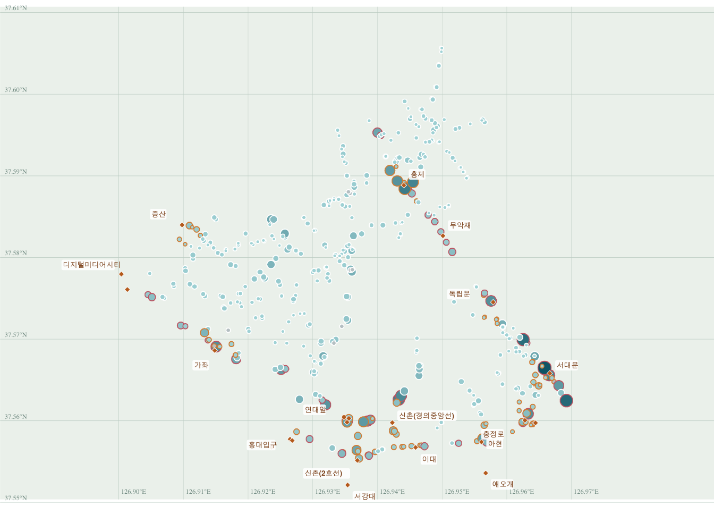

# 연세대 강화학습 프로젝트 · 4번 역할 연구 자료

서대문구 정류장 맵, 오전 7–9시 하차 실적, 철도역·연대앞 거점, 방향별 거리와 보상 설계를 정리한 저장소입니다. **모델 구현·학습·성능 비교는 이번 작업 범위에 포함하지 않았습니다.**

## 바로 보기

- [최종 연구 리포트](docs/ROLE4_FINAL_REPORT.md)
- [정류장 지도 HTML](output/role4/station_map.html) — 파일을 내려받아 브라우저로 열 수 있습니다. 좌표도·데이터·검색은 오프라인이며 도로 배경만 선택적으로 인터넷을 사용합니다.
- [모델·발표 담당자용 인계](docs/ROLE4_HANDOFF.md)
- [수요·거점·보상 명세](docs/research/DATA_REWARD_SPEC.md)
- [연구일지](docs/research/RESEARCH_LOG.md), [선행연구 분석](docs/research/LITERATURE_REVIEW.md), [독립 검토](docs/research/REVIEWS.md)
- [에이전트 지침](AGENTS.md), [팀 운영 기준](ORCHESTRATION.md)



미리보기는 생성 SVG의 정적 렌더링입니다. 점은 정류장, 주황 테두리는 거점 배정, 붉은 테두리는 중앙차로입니다. 실제 행정경계나 버스 도로 주행선이 아닙니다.

## 확인된 자료 범위

| 항목 | 개수·상태 |
| --- | --- |
| 공식 ARS 구역 13 정류장 | 464개, 2026-09-02 목록 기준 |
| 월별 수요 관측 | 매월 454개, 같은 10개는 기록 부재 |
| 방향별 도로비용 | 292개 내부 84,972쌍 |
| 전체 목록에서 미확보 도로비용 | 129,860쌍, null 유지 |
| 기본 거점 배정 | 300m 직선 반경, 103개 정류장·14그룹 |
| 전체 지역 모델 입력 준비 | **false** |

기존 282개는 이 공식 목록의 약 61%입니다. 내부 ID 112 접두어는 구 전체를 나타내지 못합니다. 이번 기준 역시 ARS 코드 기반의 시점 고정 목록이며 행정경계 폴리곤이나 현재 실제 운행 상태를 인증한 목록은 아닙니다.

수요는 기존 하차 실적의 대리 지표이며 신규 승객 수 예측이 아닙니다. 반경·보상 가중치는 명시적인 연구 가정입니다. 도로거리의 정차·회전·유턴 적합성은 미검증이고, 결측을 0이나 직선거리로 채우지 않았습니다.

## 데이터와 재생성

- `data/reference/`: 공식 자료·수요 재집계·출처
- `data/processed/role4_bundle.json`: 464개 공통 인덱스와 지도·인계 데이터
- `data/processed/stop_master.csv`, `ridership.csv`, `hub_mapping.csv`: 표 형태 산출물
- `docs/notion/`: 제공된 노션 원문과 첨부 자료
- `docs/evidence/`: 계산·자료 검증 근거

Python 데이터 변환은 표준 라이브러리를 사용합니다. 원본 자료가 있는 상태에서는 다음 명령으로 네트워크 없이 다시 생성합니다.

```powershell
python scripts/build_role4_roads.py
python scripts/build_role4_data.py
python scripts/build_role4_map.py
```

검증:

```powershell
python -m pip install -r requirements-research.txt
python -m pytest tests -q
npm ci
npm run test:map
```

Python 검증 환경은 3.13, DOM 검증은 Node 24에서 확인했습니다. jsdom은 Node 20.19 / 22.13 이상 또는 24 이상을 지원합니다. DOM 검사는 실제 브라우저 화면 배치 검사를 대신하지 않습니다. 상세 검증 범위는 인계 문서에 적었습니다.

추가 원자료 확보·독립 감사가 필요할 때는 `scripts/fetch_role4_ridership.py`와 `scripts/audit_role4.py`를 사용합니다. 새 유료 서비스나 API 키는 필요하지 않습니다.

## 기존 모델과 출처

기존 모델 코드는 [Gyuhongcho/26-2-RL](https://github.com/Gyuhongcho/26-2-RL)의 `aca14c9` 상태를 바탕으로 보존했습니다. [원래 모델 README](docs/UPSTREAM_MODEL_README.md)는 기존 실행 방식의 참고 자료입니다. 원래 `train.py`와 `network.json`은 이번 명세에 맞게 변경하지 않았습니다. 새 통합 자료를 그대로 기존 모델에 넣으면 안 되며 입력 연결은 모델 담당자의 별도 작업입니다.

서울시 공개 자료·KRIC 자료의 원문 URL과 버전·해시는 provenance 파일에 있습니다. 논문은 서지와 무료 원문 링크를 제공하며, 재배포 허가를 확인하지 않은 논문 전문은 공개 저장소에 포함하지 않습니다. 제3자 자료에 새로운 라이선스를 부여하지 않습니다.
