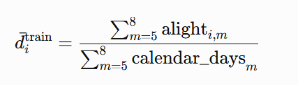

# 주아 3번 업무

강의에서 배운 방법을 버스 노선 설계에 연결하고, 비교할 알고리즘·학습 절차·평가 방법을 정리

같은 후보 정류장과 거리 제약 아래에서 무작위·탐욕법·강화학습을 비교

DP로 최적값을 구해 학습 결과를 평가하고, 상태 공간이 커질 경우 DQN을 확장 방법으로 검토

## 1. 프로젝트 목표

서대문구를 중심으로 연세대와 이대·아현 주변 생활권을 연결하는 마을버스 노선 1개를 설계한다. 출발점과 종점을 고정하고, 총거리 상한 안에서 이용량 점수와 거점 연결 보상을 높이는 정류장 방문 순서를 찾는다.

기존 정류장의 오전 7–9시 하차량을 수요 대리 지표로 사용한다. 결과는 **설정한 이용량 점수와 거리 제약 아래의 노선 비교**로 해석하며, 신규 노선의 실제 탑승객 수를 예측한 값으로 해석하지 않는다.

## 2. 데이터 사용 기준

| 자료 | 사용 내용 | 방법론에 연결되는 부분 |
| --- | --- | --- |
| `01_region_stations_clean.csv` | 정류장 ID·좌표·유형·마을버스 정차 가능 표시 | 후보 정류장 확인 |
| `02_region_ridership_7to9_monthly.csv` | 월별 오전 7–9시 하차량, 학습·검증 구분 | 기본 수요 점수 산정 |
| `13_candidate_pool_v2_PROPOSAL.csv` | 후보 40개, 거점 태그, 학습 기간 하차량 | 예비실험 후보 목록 |
| `14_candidate_v2_road_distance_matrix_m.csv` | 후보 40개 간 방향별 도로 거리 | 상태 전이·거리 비용·행동 마스크 |
| `12_station_osm_snap.csv` | 도로 연결 및 거리 품질 | 최종 노선의 이상 구간 점검 |
| `08_remaining_validation_notes.csv` | 거리·통행·수요 보정의 검토 사항 | 가정과 한계 정리 |

### 2.1. 후보와 거리

- 808개 전체 자료 중 후보안 40개를 예비실험에 사용한다. 본실험에서 후보를 20–30개로 줄이면 모든 방법에 같은 최종 목록을 적용한다.
- 40×40 거리 행렬은 후보 ID와 일치하며 결측값이 없다.
- 거리 행렬의 **행은 출발 정류장, 열은 도착 정류장**이고 단위는 m이다.
- 일방통행 등의 영향으로 A→B와 B→A의 거리가 다르므로 방향을 구분한다.
- 서로 다른 정류장 쌍 780개 중 779개는 양방향 거리가 0.1m를 초과해 다르다. 양방향 차이의 중앙값은 약 286m다.

### 2.2. 수요 기준

**기본 실험은 하차량 기준으로 진행한다.** 사용 열은 `alight_07_09`이며, 이는 월간 오전 7–9시 하차량 합계다.

학습 기간은 2026년 5–8월, 검증 기간은 9–10월로 구분한다. 정류장 i의 학습 기간 일평균 하차량은 다음과 같이 계산한다.

월별 일평균의 단순평균 대신, 기간 전체 하차량을 기간 전체 일수로 나눠 월별 일수 차이를 반영한다. 이 값에는 주말과 공휴일도 포함된다. `weekday_avg_07_09_est`는 승하차 합계의 평일 추정치이므로 하차량 보상에 그대로 사용하지 않는다.

최종 후보 집합을 기준으로 학습 기간 최소값과 최대값을 구해 정규화한다.

최대값과 최소값이 같으면 모든 점수를 0으로 두는 예외 처리를 한다. 검증 기간에도 학습 기간의 정규화 기준을 그대로 사용한다. 검증 점수가 0–1 범위를 벗어날 수 있으며, 기본 분석에서는 잘라내지 않는다.

후보 파일의 `alight_07_09_train`은 5–8월 하차량 합계와 일치하므로 같은 후보를 유지하면 이를 활용할 수 있다. 기존 `demand_score_minmax`와 `demand_score_log_minmax`는 하차 기준으로 다시 계산한다.

**수요 해석 시 주의할 점**

- 후보 40개의 승차량·하차량 순위 상관은 약 −0.19이므로 기준을 바꾸면 방문 정류장이 달라질 수 있다.
- 기존 점수에서 이대역 정류장이 거의 0이라고 해서 하차 수요까지 거의 없는 것은 아니다. 하차량을 기준으로 후보 40개를 다시 정규화하면 이대전철역은 약 0.254, 이대역5번출구는 약 0.236이다.
- 승차량 또는 승하차 합계 기준은 기본 분석을 마친 뒤 추가 비교로 다룬다. 기준을 바꿀 때는 정규화와 보상도 함께 다시 계산한다.

### 2.3. 거점과 정류장 그룹

프로젝트의 우선 거점은 **연대앞·이대·아현**이다. 후보 파일의 기존 태그인 신촌·이대·아현을 그대로 보상에 사용하지 않고, 지도 담당과 정한 거점별 정류장 ID 목록을 사용한다.

- 연대앞 후보: 연세대학교앞(`112000031`), 연대앞.세브란스병원(`112900188`) 등.
- 이대·아현도 역 주변 거점을 의미하는지, 넓은 생활권을 의미하는지에 맞춰 정류장 목록을 정한다. 이름에 ‘이대’ 또는 ‘아현’이 들어간다는 이유만으로 자동 포함하지 않는다.
- 같은 거점의 여러 정류장을 방문해도 거점 보너스는 한 번만 지급한다.
- 출발 거점은 시작 시 이미 방문한 것으로 처리하고 보너스를 지급하지 않는다.
- 이대·아현은 기본 실험에서 보너스를 주는 우선 거점이다. 반드시 방문해야 하는 필수 제약으로 설정한 것은 아니다.
- 가까운 양방향 정류장은 별도 ID로 유지한다. 실제로 같은 접근 지점을 나타내는 경우에는 위치그룹을 정의하고, 그룹당 정차 횟수를 제한하는 추가 실험을 할 수 있다.

연세대학교앞(`112000031`)과 신촌기차역(`112000128`)은 거리 품질이 `check`이므로 최종 노선에 포함되면 지도에서 연결 구간을 점검한다.

## 3. 강화학습 문제로 보는 이유

정류장을 하나 선택하면 현재 위치뿐 아니라 남은 거리, 이후에 방문할 수 있는 정류장이 달라진다. 당장 점수가 높은 정류장을 고르는 것이 최종적으로 좋은 노선을 보장하지는 않는다.

강화학습은 **현재 선택 이후에 얻을 보상까지 고려한 행동가치**를 학습한다. 이 프로젝트에서는 실제 버스를 운행하면서 학습하는 대신, 전처리한 거리와 수요로 만든 환경에서 노선을 반복 생성하며 학습한다.

| 강의 내용 | 프로젝트에 적용하는 의미 | 연결 주차 |
| --- | --- | --- |
| 정책·보상·가치함수 | 다음 정류장을 고르는 규칙과 그 규칙의 장기적 성과 | 1주차 2회차 |
| MDP·마르코프 성질 | 이후 선택에 필요한 정보를 상태에 포함 | 2주차 1회차 |
| 에피소드·누적보상 | 노선 하나를 완성하는 과정과 총점 | 2주차 1회차 |
| 벨만 방정식·DP | 현재 보상과 이후 가치를 연결하고 최적값 계산 | 2주차 1회차, 3주차 |
| MC·TD 제어 | 반복 생성한 노선 경험으로 행동가치 학습 | 4주차, 5주차 |
| 함수근사·DQN | 상태 공간이 커질 때 가치함수를 근사 | 8주차 |

## 4. MDP 설계

### 4.1. 상태·행동·전이

상태는 다음과 같이 정의한다.

| 기호 | 의미 | 필요한 이유 |
| --- | --- | --- |
| i_t | 현재 정류장 | 다음 정류장까지의 거리가 현재 위치에 따라 다름 |
| V_t | 이미 정차한 정류장 집합 | 재정차 방지, 거점 보너스 중복 방지 |
| b_t | 남은 이동거리 | 선택 가능한 후보와 종점 도달 가능성 판단 |

거점별 방문 여부는 고정된 거점 목록과 방문 집합에서 계산한다. 위치그룹 제한을 추가하는 경우 그룹 방문 여부도 방문 집합에서 계산한다.

행동은 **다음에 정차할 정류장 j를 선택하는 것**이다. 정류장 사이의 실제 이동 경로는 주어진 도로망 최단거리로 처리한다.

여기서 재방문 금지는 **같은 정류장에서 다시 정차하지 않는다는 뜻**이다. 두 정차 지점 사이의 도로 경로가 이전에 지난 도로를 다시 지나가는 것까지 금지하는 모델은 아니다.

**강의 연결:** 2주차 1회차의 MDP, 상태별 행동 집합, 마르코프 성질.

### 4.2. 거리 관리와 행동 마스크

남은 거리를 100m 단위로 올림해 행동 가능 여부를 판단하지 않는다. 원자료의 0.1m 단위를 정수로 변환해 관리한다.

거리 비용을 계산할 때 km 단위로 되돌린다. 원자료 자체의 도로망 오차와 별개로, 구현 중 부동소수점 오차 때문에 거리 제한을 넘는 문제를 줄이기 위한 처리다.

다음 조건을 모두 만족하는 정류장만 선택한다.

1. 아직 정차하지 않은 정류장이다.
2. 현재 위치에서 이동을 허용한 구간이다.
3. 그 정류장으로 이동한 뒤에도 지정 종점 g로 갈 거리가 남는다.

완전한 후보 간 거리 행렬을 사용하는 기본 실험에서는 다음과 같이 계산한다.

종점은 항상 행동 후보에 포함하고, 현재 위치에서 종점까지의 거리가 남은 거리 이내일 때 선택할 수 있다. 종점의 자기 자신까지 거리는 0이다.

이 조건을 모든 방법과 학습 타깃 계산에 공통 적용한다. 초기 상태가 유효하고, 같은 거리 자료와 위 전이를 일관되게 사용하면 선택한 다음 정류장에서도 종점으로 직접 갈 수 있는 선택지가 남는다.

**기본 실험에서는 가까운 8개 제한을 두지 않는다.** 계산량을 줄이는 추가 실험에서 제한을 사용한다면, 현재 위치에서의 방향별 도로 거리로 전체 후보 중 k개를 미리 정하고 방문 정류장을 제외한다. 종점은 별도로 추가하고 거리 마스크를 적용한다. k 제한은 모든 비교 방법과 DP에 동일하게 적용한다.

k 제한 실험의 최적값은 해당 제한 안에서의 최적값이다. 전체 후보를 연결한 문제의 최적값과 구분해 보고한다.

**강의 연결:** 2주차 1회차의 상태별 행동 집합. 구체적인 거리 마스크와 k 제한은 프로젝트 자체 설계.

### 4.3. 보상

| 보상 항목 | 의미 |
| --- | --- |
| d_j | 새 정류장의 학습 기간 하차량 점수 |
| β | 새 우선 거점을 연결했을 때 받는 보너스 |
| λ | 도로 1km 이동당 비용 |

출발점의 기본 점수는 지급하지 않는다. 종점의 기본 점수도 모든 노선에서 같은 상수이므로 학습 보상에서는 0으로 둔다. 종점 거점의 보너스를 포함한다면 최초 방문 시 한 번만 지급하며, 고정 종점에 항상 부여되는 보너스 역시 노선 간 순위를 바꾸지 않는 상수라는 점을 함께 기록한다.

평가표의 ‘기본 이용량 점수’는 출발점·종점을 제외한 경유 정류장 점수 합계로 통일한다. 전체 정차 지점 이용량을 별도로 제시할 때는 출발점·종점 포함 여부를 표에 명시한다.

### 4.4. 종료와 학습 목표

지정 종점에 도착하면 에피소드를 종료한다. 시작 시 출발점을 방문 집합에 넣고 정차한 정류장은 다시 선택할 수 없으므로 에피소드 길이는 후보 수에 의해 제한된다.

총거리 상한을 만족하면서 다음 누적보상을 최대화한다.

할인율을 1로 두는 이유는 정류장 방문 순서에 따른 추가 할인 없이 노선 전체의 점수를 비교하기 위해서다. 종료 상태의 이후 가치는 0으로 둔다.

**강의 연결:** 2주차 1회차의 에피소드와 반환, 3주차 1회차의 γ=1일 때 종료 조건.

## 5. 비교 방법과 선정 이유

### 5.1. 구현 우선순위

| 우선순위 | 방법 | 역할 | 강의 연결 |
| --- | --- | --- | --- |
| 필수 | 무작위 선택 | 같은 제약 아래 학습 없이 생성한 노선과 비교 | 비교 방식은 자체 설계 |
| 필수 | 탐욕법 | 당장의 수요·거점·거리 효율만 보는 방법과 비교 | 1주차 2회차의 greedy 개념과 연결. 구체적 기준은 자체 설계 |
| 필수 | 작은 문제의 메모이제이션 DP | 최적값과 최적 노선 계산, 환경·학습 검증 | 2주차 벨만 최적 방정식, 3주차 DP |
| 주 학습 방법 | 표 형태 Q-learning | 미래 행동가치를 반영하는 학습 방법 | 5주차 1회차 |
| 추가 비교 | Sarsa | 다음에 실제 선택한 행동으로 갱신하는 방식과 비교 | 5주차 1회차 |
| 확장 | DQN, 필요 시 Double DQN | 표 방식의 한계가 나타날 때 함수근사 비교 | 8주차 1·2회차 |
| 후순위 | MC 제어, n-step Sarsa, REINFORCE | 기본 비교를 마친 뒤 학습 방식 확장 | 각각 4주차, 6주차 1회차, 9주차 1회차 |

무작위 방법은 기본 비교 기준이며, 모든 경우의 성능 하한을 보장하는 방법은 아니다. 모든 강의 알고리즘을 구현하기보다 기본 비교와 하나의 RL 방법을 먼저 완성한다.

### 5.2. 무작위 선택과 탐욕법

**무작위 선택:** 유효 행동 집합 A(s)에서 균등하게 선택한다. 여러 번 노선을 생성해 평균·표준편차를 보고한다.

**탐욕법:** 유효 후보 중 다음 점수가 가장 큰 정류장을 선택한다.

분모의 최솟값은 1m에 해당하며 0 나눗셈을 방지하기 위한 값이다. 점수가 같으면 정류장 ID 순으로 선택한다. 목적함수의 거리 비용 λ는 생성한 노선을 평가할 때 공통 적용한다. 이 비율 규칙이 목적함수 자체를 정확하게 최적화하는 것은 아니다.

탐욕법은 앞으로 갈 수 있는 다른 정류장의 가치를 학습하지 않는다. 반면 Q값에 따른 greedy 선택은 이후 누적보상의 추정치를 기준으로 고른다는 점에서 다르다.

### 5.3. DP: 최적값 계산과 검증

환경의 거리·보상·전이를 알고 있으므로 벨만 최적 방정식에 따라 계산할 수 있다.

방문 집합이 매 단계 늘어나므로, 방문 수에 따른 순서를 활용한 재귀와 메모이제이션으로 계산한다. 이는 강의의 벨만 최적 원리를 이용한 DP 구현이며, 전체 상태를 반복 갱신하는 가치반복과 구현 절차는 구분한다.

- 정류장 5개 정도의 작은 예제로 시작해 최적 노선·보상을 확인한다.
- 이후 후보 수와 거리 상한을 늘리면서 실행시간·메모리·도달 상태 수를 기록한다.
- 계산이 완료된 조건에만 J*라는 표현과 최적값 대비 차이를 사용한다.
- 계산을 중단한 조건의 현재 최고 점수는 ‘발견한 최선값’으로 기록하고 정답으로 부르지 않는다.

기존 초안의 100m 구간화 기반 상태 수 표는 본 계획의 실행 가능성 근거로 사용하지 않는다. 거리 처리와 행동 제한을 통일한 구현에서 다시 측정한다. ‘5km 이하면 가능, 6km 이상이면 불가능’과 같은 고정 경계도 두지 않는다.

### 5.4. Q-learning: 주 학습 방법

현재 선택으로 받은 보상과 다음 상태에서의 최대 행동가치를 함께 사용한다. 탐색 행동을 하더라도 갱신에는 다음 상태의 최대 Q값을 사용하므로 off-policy TD 제어에 해당한다.

- 상태 키는 현재 정류장·방문 비트마스크·0.1m 단위 남은 거리로 구성한다.
- 방문한 상태·행동 쌍만 사전에 저장한다.
- 다음 상태의 최대값은 **유효 행동만 대상으로** 계산한다.
- 종점에 도착한 경우 학습 타깃은 r이며 이후 가치를 더하지 않는다.
- 동일한 환경에서 노선을 반복 생성해 학습하고, 평가 때는 탐색을 끈다.

표 방식은 원리를 설명하고 구현 결과를 점검하기 좋다. 다만 후보 수, 거리 상한, 거리 정밀도, 행동 제약에 따라 상태 수가 커지므로 학습 가능성은 예비실험으로 판단한다.

### 5.5. Sarsa: 추가 비교

a'는 다음 상태에서 탐색 정책으로 실제 선택한 행동이다. Q-learning과 같은 환경·탐색 일정·학습 예산을 사용하고, 다음 상태의 최대값으로 갱신하는 방식과 실제 선택 행동으로 갱신하는 방식의 차이를 비교한다.

탐색 중 학습 반환과 탐색을 끈 평가 노선의 점수를 구분한다. 행동 마스크가 위험한 행동을 이미 제외하므로, Sarsa가 Q-learning보다 반드시 안전하거나 우수할 것이라고 가정하지 않는다.

### 5.6. DQN: 상태 공간이 클 때의 확장

표 형태 학습에서 메모리 사용이 커지거나 새 상태가 계속 늘어 충분한 학습이 어려우면 DQN을 검토한다. DQN은 Q-table 대신 신경망 Qθ(s,a)로 행동가치를 근사한다.

| 항목 | 초기 구현안 |
| --- | --- |
| 입력 | 현재 정류장 one-hot N개 + 방문 여부 N개 + 남은 거리/B 1개 |
| 출력 | 다음 정류장 후보 N개의 Q값 |
| 네트워크 | 은닉층 128–128, ReLU |
| 경험 재사용 | 리플레이 버퍼에 전이 저장 후 미니배치 학습 |
| 타깃 안정화 | 별도의 타깃 네트워크 사용 |
| 행동 제한 | 행동 선택과 다음 상태 타깃의 max 계산 모두에 마스크 적용 |

거점 방문 여부는 방문 벡터와 고정된 거점 목록에서 결정된다. 기본 실험은 학습 기간 평균 수요를 고정해서 사용한다. 향후 수요나 출발·종점 자체가 바뀌는 환경까지 한 모델로 학습하려면 해당 정보도 입력에 포함하는 별도 설계가 필요하다.

표준 DQN의 학습 타깃은 다음과 같다.

Double DQN은 다음 행동 선택에 온라인 네트워크를, 선택한 행동의 가치 평가에 타깃 네트워크를 사용한다. DQN을 구현한 뒤 과대추정이나 학습 변동을 살펴볼 때 추가한다.

함수근사가 표 방식보다 항상 우수한 것은 아니다. 특히 함수근사·부트스트래핑·off-policy 학습을 결합할 때 불안정성이 생길 수 있으므로, 선형 근사 Q-learning을 단순한 대체 정답으로 두지 않는다. 작은 문제의 최적값, 학습 곡선, 시드별 편차로 결과를 평가한다.

**강의 연결:** 6주차 1회차의 deadly triad, 8주차 1회차의 함수근사, 8주차 2회차의 DQN·타깃 네트워크·경험 재생·Double DQN.

## 6. 탐색 전략과 초기 학습 설정

### 6.1. ε-greedy 탐색

- 확률 ε로 유효 행동 중 무작위 선택한다.
- 확률 1−ε로 유효 행동 중 Q값이 가장 큰 행동을 선택한다.
- 초반에는 다양한 정류장 조합을 시도하고, 학습 후반에는 학습한 선택을 더 자주 사용한다.

여기서 ε-greedy는 **학습 중 탐색 방식**이고, 비교 기준인 수요/거리 탐욕법은 **노선을 생성하는 별도 알고리즘**이다.

**강의 연결:** 1주차 2회차의 greedy·ε-greedy, 4주차 2회차의 탐색을 포함한 제어.

### 6.2. 초기 설정표

아래 값은 예비실험을 시작하기 위한 자체 설정이다. 강의가 보장하거나 지정한 최적값으로 제시하지 않는다.

| 항목 | 초기 설정 | 점검·변경 기준 |
| --- | --- | --- |
| 예비 후보 | 13번 파일의 40개 | 본실험의 최종 후보로 바꾸면 모든 방법 공통 변경 |
| 예비 출발점 | 연대앞.세브란스병원, 112900188 | 지도 담당의 최종 출발점에 맞춰 공통 변경 |
| 예비 종점 | 아현전철역, 113900302 | 지도 담당의 최종 종점에 맞춰 공통 변경 |
| 거리 상한 B | ρ × 출발→종점 도로 최단거리, ρ=1.6 | 1.3, 1.6, 2.0 비교 |
| 할인율 γ | 1 | 유한한 에피소드의 총점 비교 |
| 거리 비용 λ | 0.2/km | 0, 0.2, 0.4 비교 |
| 거점 보너스 β | 0.5 | 0, 0.5, 1.0 비교 |
| Q 초기값 | 0 | 모든 표 방식에 동일 적용 |
| 표 방식 학습률 η | 0.1 | 필요 시 0.05, 0.3 비교 |
| 탐색률 ε | 1.0→0.05 | 총 학습 전이 예산의 70%까지 선형 감소 후 유지 |
| 예비 학습 예산 | 학습용 환경 전이 20만 회/시드 | 실행시간과 학습 곡선을 보고 본실험 예산 확정 |
| 중간 평가 | 학습용 환경 전이 1만 회마다 | 탐색을 끈 정책의 점수 기록 |
| 반복 시드 | 예비 3개, 본실험 목표 10개 | 자원에 따라 줄이면 실제 반복 수 명시 |

거리 상한 배율은 ρ, 학습률은 η로 표기해 서로 다른 설정에 α를 중복 사용하지 않는다.

### 6.3. DQN 초기 설정

| 항목 | 초기값 |
| --- | --- |
| 최적화 | Adam, 학습률 0.001 |
| 배치 크기 | 64 |
| 리플레이 버퍼 | 50,000개 전이 |
| 학습 시작 | 1,000개 전이 수집 후 |
| 업데이트 | 학습 시작 후 환경 전이 1회당 미니배치 갱신 1회 |
| 타깃 네트워크 | 학습 업데이트 1,000회마다 동기화 |
| 손실 | Huber loss |
| 탐색·평가 예산 | 표 방식과 같은 환경 전이 예산을 우선 적용 |

학습 손실이 낮아지는 것만으로 좋은 노선이 만들어졌다고 판단하지 않는다. 평가 정책의 보상과 실제 노선을 함께 확인한다.

- 학습 방법 간에는 학습용 환경 전이 횟수를 우선 맞춘다. 에피소드 길이가 다를 수 있으므로 에피소드 수만 같게 두지 않는다.
- 평가용 전이는 학습에 사용하지 않고 별도로 센다.
- 학습 횟수 외에 실제 실행시간과 메모리도 기록한다. 같은 상호작용 예산이 같은 계산 비용을 의미하지는 않는다.
- ‘상태·행동 수의 20배 에피소드면 충분하다’는 규칙을 사용하지 않는다. 자주 방문하는 상태와 거의 방문하지 않는 상태가 다를 수 있다.
- 고정 학습률·유한 학습 예산·최소 탐색률을 사용하는 실험이므로 이론적 최적 수렴을 보장한다고 표현하지 않는다.

## 7. 학습과 구현 순서

1. **공통 환경 구성**: 후보·거점 목록·수요·거리·출발·종점·보상 설정을 한 곳에서 관리한다.
2. **작은 예제 검증**: 정류장 5개 정도에서 완전탐색과 DP의 최적값이 일치하는지 확인한다.
3. **환경 제약 확인**: 재정차 금지, 거리 차감, 종점 도착, 거점 최초 보너스, 종료 상태 가치 0을 점검한다.
4. **기준선 생성**: 같은 마스크를 적용한 무작위·탐욕법 노선을 만든다.
5. **Q-learning 예비실험**: 실행시간, 저장된 상태·행동 수, 학습 곡선과 평가 노선을 확인한다.
6. **주 비교 실험**: 기본 조건을 고정하고 반복 시드 실험을 진행한다. 시간이 허용되면 Sarsa를 추가한다.
7. **확장 판단**: 표 방식의 메모리·학습 진행 상황을 보고 DQN을 추가한다. 상태 공간이 큰 조건의 비교가 목적이면 그 이유를 기록한다.
8. **민감도·월별 재평가**: 보너스, 거리 상한, 거리 비용을 바꾼 결과와 검증 기간 결과를 정리한다.

후보 수를 줄인 문제에서 좋은 결과를 얻었다고 해서 전체 후보 문제에서도 같은 결과를 보장한다고 해석하지 않는다.

## 8. 실험 계획

처음부터 모든 설정의 조합을 돌리지 않고 기본 비교를 완료한 뒤 한 축씩 확장한다.

| 번호 | 실험 | 비교 내용 | 목적 |
| --- | --- | --- | --- |
| E0 | 환경·정답 검증 | 작은 문제에서 완전탐색 vs DP | 거리·보상·종료 구현 확인 |
| E1 | 기본 성능 비교 | 무작위·탐욕법·Q-learning, 가능하면 Sarsa와 DP | 학습으로 최종 노선 점수가 개선되는지 확인 |
| E2 | 거점 보너스 | β=0, 0.5, 1.0 | 거점 연결과 수요·우회거리의 변화 확인 |
| E3 | 거리 상한 | ρ=1.3, 1.6, 2.0 | 허용 거리가 늘 때 방문 수·성능·상태 수 변화 확인 |
| E4 | 거리 비용 | λ=0, 0.2, 0.4 | 추가 정차의 점수와 우회 비용 사이의 변화 확인 |
| E5 | 이후 기간 재평가 | 학습 기간 정책·노선을 9–10월 하차량으로 평가 | 시간에 따른 수요 변화에 대한 성능 확인 |
| E6 | 함수근사 확장 | 같은 조건의 표 Q-learning vs DQN | 상태 공유의 이점과 학습 비용 비교 |
| E7 | 추가 민감도 | 수요 기준·k 제한·위치그룹 제한 중 필요한 항목 | 설계 가정에 따른 노선 변화 확인 |

### 8.1. 결과 지표

| 지표 | 정의·해석 |
| --- | --- |
| 총 누적보상 J | 학습 목표와 같은 보상 합계 |
| 최적값 대비 차이 J*−J | 동일 조건에서 최적값이 계산된 경우에만 사용 |
| 기본 이용량 점수 | 경유 정류장의 하차량 점수 합계 |
| 우선 거점 방문 수 | 출발 시 이미 방문한 거점을 제외하고 새로 연결한 거점 수 |
| 총 도로 거리 | 생성 노선의 방향별 구간 거리 합계 |
| 경유 정류장 수 | 출발·종점을 제외한 정차 수 |
| 유효 노선 완성률 | 종점 도착·거리 상한·재정차 금지 등 제약 충족 비율 |
| 학습 비용 | 환경 전이 수, 실행시간, 메모리, 저장된 상태·행동 수 |
- 최적값이 0이거나 음수일 수 있으므로 기본 지표는 비율보다 절대 차이 J*−J를 사용한다.
- 최적해 도달 비율은 같은 방문 순서를 얻은 비율이 아니라, 정한 수치 허용오차 안에서 최적 보상에 도달한 학습 시드의 비율이다.
- 학습 방법은 시드별 결과의 평균·표준편차를 제시하고, 무작위 방법은 여러 독립 생성 노선의 평균·표준편차를 제시한다.
- 고정 환경의 결정적 정책을 같은 조건에서 반복 실행하면 같은 노선이 나올 수 있다. 학습 시드 간 차이와 실행 중 무작위성을 구분한다.
- 거점 보너스나 λ를 바꾼 실험은 목적함수가 달라지므로 J값만 직접 비교하지 않는다. 이용량 점수·거점 수·총거리를 함께 제시한다.

행동 마스크가 올바르게 구현된 기본 환경에서는 무작위 방법도 유효 노선을 만들 수 있다. 이 경우 완성률은 알고리즘 우열보다 환경 구현의 점검 지표로 활용한다.

### 8.2. 검증 기간 평가

5–8월 수요로 학습하고, 정규화 기준과 학습된 모델을 고정한 뒤 평가 노선을 생성한다. 그 노선의 방문 순서를 바꾸지 않고 9–10월 하차량 점수로 재계산한다.

\[
J_{\mathrm{val}}(R_{\mathrm{train}})
\]

검증 기간 수요의 최적값을 구할 수 있으면 같은 후보·거리·보너스 조건에서 다음 차이도 계산한다.

\[
J^*_{\mathrm{val}}-J_{\mathrm{val}}(R_{\mathrm{train}})
\]

이는 이후 수요를 미리 알았을 때 가능한 최선과 학습 기간에 선택한 노선의 차이다. 검증 수요를 보고 노선을 다시 고른 결과와 구분한다.

9–10월 결과로 알고리즘이나 설정을 선택했다면 해당 기간은 검증용이다. 별도의 최종 테스트 기간으로 표현하지 않는다. 5–8월에는 방학이 포함되므로 후보 순위 상관만으로 계절 영향이 없다고 단정하지 않고, 월별 노선 점수도 함께 확인한다.

## 강의 주차별 연결 정리

아래 주차 표기는 제공된 「학습 전략 및 학습 계획(3번 담당)」의 강의 매핑을 기준으로 정리했다. 프로젝트의 보상식·마스크·설정값·실험 설계는 강의 개념을 적용한 자체 설계다.

| 주차·회차 | 강의 자료 | 강의에서 연결할 내용 | 프로젝트 적용 |
| --- | --- | --- | --- |
| 1주차 1회차 | `week1_1_orientation` | 보상 해킹·과최적화 | 점수와 실제 노선 목적이 어긋나는지 점검 |
| 1주차 2회차 | `week1_2_introduction` | 정책·보상·가치·모델, greedy·ε-greedy, 점진적 갱신, 학습률 | 방법별 차이 설명, 탐색 전략과 학습 설정 |
| 2주차 1회차 | `week2_1_finite_mdp` | MDP, 마르코프 성질, 상태별 행동 집합, 에피소드·반환, 가치함수·벨만 방정식 | 현재 위치·방문 집합·남은 거리 정의, 총보상 목표 |
| 3주차 1회차 | `week3_1_dp` | 정책평가, 종료 상태, γ=1일 때의 조건 | 작은 환경의 가치 검증, 종료·할인율 설정 |
| 3주차 2회차 | `week3_2_dp` | 정책개선·정책반복·가치반복, 동점 처리 | 최적 행동 선택 원리와 DP 비교 기준 |
| 4주차 1회차 | `week4_1_MC` | MC 예측, first-visit·every-visit | 한 에피소드의 반환으로 값을 추정하는 방법 설명 |
| 4주차 2회차 | `week4_2_MC` | MC 제어, ε-soft 정책 | MC를 추가 비교할 때의 탐색과 제어 |
| 5주차 1회차 | `week5_1_TD` | TD(0), Sarsa, Q-learning, 최대화 편향·Double Q | 주 학습 방법과 추가 비교 방법, 부트스트래핑 설명 |
| 6주차 1회차 | `week6_1_nstep_Bootstrap` | n-step 방법, 함수근사·부트스트래핑·off-policy 결합의 불안정성 | 선택 확장과 함수근사 결과 해석 |
| 6주차 2회차 | `week6_2_intro_dgm` | 생성모델 개요 | 기본 노선 선택 알고리즘에는 직접 사용하지 않음 |
| 7주차 1회차 | `week7_1_VAE_DDPM` | VAE·DDPM | 기본 노선 선택 알고리즘에는 직접 사용하지 않음 |
| 8주차 1회차 | `week8_1_Approximation` | 표 방식의 한계, 가치함수 근사, 선형 근사 | 상태 공간 규모에 따른 근사 방법 검토 |
| 8주차 2회차 | `week8_2_Control_Approximation` | 근사를 이용한 제어, DQN, 경험 재생, 타깃 네트워크, Double DQN | DQN 확장 설계와 표 방식 비교 |
| 9주차 1회차 | `week9_1_PolicyGradient I` | softmax 정책, REINFORCE, baseline, actor-critic | 기본 실험 이후 정책 기반 방법을 추가할 때 활용 |

### 발표에서 강조할 연결

1. **2주차 MDP**: 왜 현재 위치 외에 방문 기록과 남은 거리가 필요한가?
2. **3주차 DP**: 모델을 알고 있을 때 구할 수 있는 최적값을 어떻게 비교 기준으로 사용하는가?
3. **5주차 Q-learning·Sarsa**: 당장 수요가 높은 정류장과 이후 누적보상이 높은 정류장은 어떻게 다른가?
4. **8주차 함수근사·DQN**: 상태가 많아질 때 표 대신 신경망을 쓰는 이유와 추가 비용은 무엇인가?
5. **1주차 보상 설계**: 높은 점수의 노선이 실제 연결 목적에도 맞는지 어떻게 확인하는가?